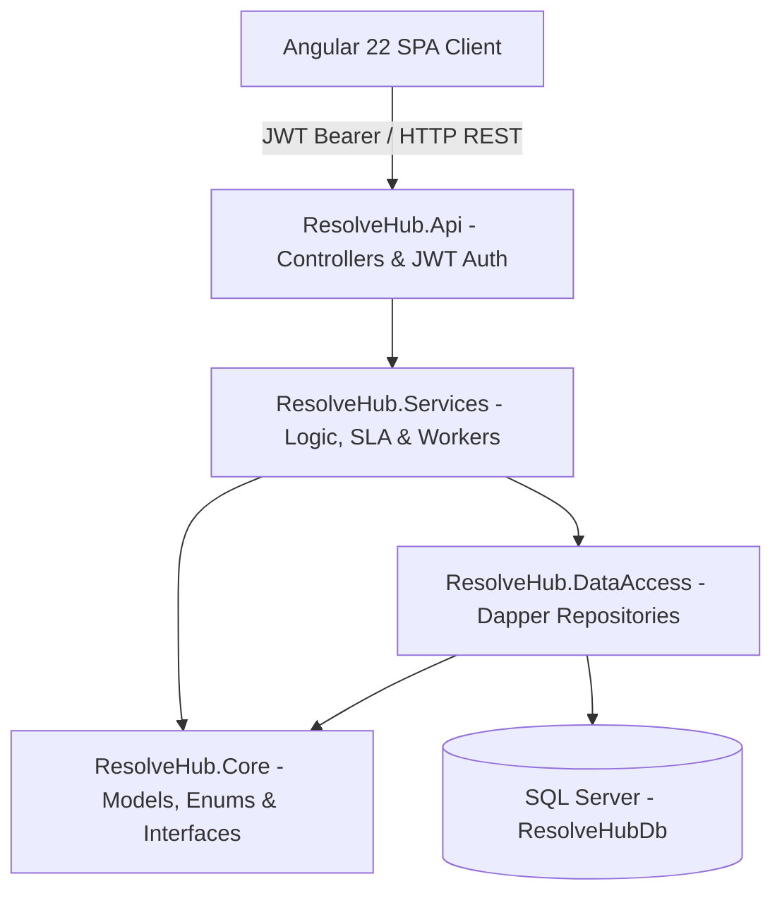
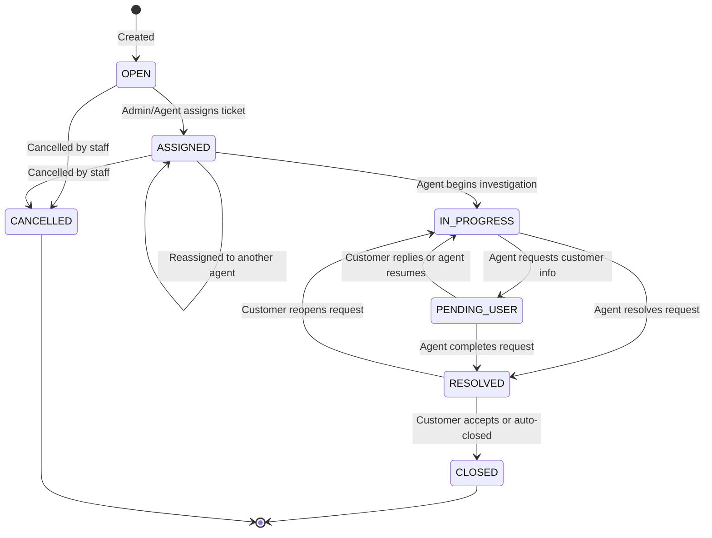

# ResolveHub &bull; Comprehensive Developer Guide & Technical Reference

ResolveHub is an enterprise service desk, multi-tenant operations, and SLA lifecycle platform. It features an ASP.NET Core (.NET 10) backend utilizing Clean Architecture with Dapper and Microsoft SQL Server, paired with an Angular 22 standalone frontend providing strictly segregated portals for **System Administrators / Support Agents** and **Employees / Requester Users**.

---

## Table of Contents
1. [System Architecture & Core Principles](#1-system-architecture--core-principles)
2. [Project & Solution Structure](#2-project--solution-structure)
3. [Database Architecture & Stored Procedures](#3-database-architecture--stored-procedures)
4. [Authentication, Security & Role-Based Access Control (RBAC)](#4-authentication-security--role-based-access-control-rbac)
5. [Ticket Lifecycle & SLA Engine](#5-ticket-lifecycle--sla-engine)
6. [Frontend Architecture (Angular 22 Standalone)](#6-frontend-architecture-angular-22-standalone)
7. [Comprehensive API Reference](#7-comprehensive-api-reference)
8. [Local Development Setup & Environment Initialization](#8-local-development-setup--environment-initialization)
9. [Automated Testing & Verification Suite](#9-automated-testing--verification-suite)
10. [Engineering Standards, Best Practices & Anti-Patterns](#10-engineering-standards-best-practices--anti-patterns)
11. [Troubleshooting & Frequently Asked Questions](#11-troubleshooting--frequently-asked-questions)

---

## 1. System Architecture & Core Principles



### Architectural Principles
1. **Authoritative JWT Identity**:
   - All user context (`UserId`, `CompanyId`, `Role`, `Email`) is extracted authoritatively on the backend from validated JWT claims using `ICurrentUserService`.
   - Client-supplied identifiers in query parameters or request bodies (such as `userId` or `companyId`) are ignored or rejected to guarantee zero cross-tenant or cross-user data leakage.
2. **Strict Dual-Portal Separation**:
   - **Admin / Agent Portal** (`/dashboard`, `/departments`, `/categories`, `/priorities`, `/tickets`, `/sla-policies`, `/users`, `/reports`): Comprehensive operations, assignee management, taxonomy configuration, analytics, and user provisioning.
   - **Employee Requester Portal** (`/user/dashboard`, `/user/raise-ticket`, `/user/tickets`, `/user/profile`): Streamlined self-service interface for employees to create requests, monitor progress, reply with public comments, and close or reopen resolved tickets.
3. **Database-Enforced Workflows via Stored Procedures**:
   - All core transactional operations run through 58 parameterized SQL Server stored procedures.
   - Guarantees strict ACID compliance, tenant data isolation via `CompanyId`, and atomic status transitions.
4. **Resilient Background Workers**:
   - `SlaMonitoringWorker`: Continuously monitors active tickets against configured response and resolution thresholds, logging warnings and breaches.
   - `NotificationDeliveryWorker`: Polls queued notifications and delivers emails or in-app alerts asynchronously.

---

## 2. Project & Solution Structure

```text
ResolveHub/
├── ResolveHub.slnx                         # .NET 10 Solution File
├── DEVELOPER_GUIDE.md                      # Complete Developer Reference Manual
├── src/
│   ├── ResolveHub.Api/                     # ASP.NET Core Web API
│   │   ├── Controllers/                    # REST API Controllers (Auth, Ticket, Category, etc.)
│   │   ├── Middleware/                     # Global exception & logging middleware
│   │   ├── Program.cs                      # Service registrations, JWT setup, OpenAPI/Scalar
│   │   └── appsettings.json                # Connection strings, JWT secrets, SLA/worker config
│   │
│   ├── ResolveHub.Core/                    # Domain Layer (Zero External Dependencies)
│   │   ├── DTOs/                           # Request & Response Data Transfer Objects
│   │   ├── Entities/                       # Domain Entities (Ticket, Department, User, etc.)
│   │   ├── Enums/                          # Domain Enums (TicketStatus, Priority, Role)
│   │   └── Interfaces/
│   │       ├── Repositories/               # Repository interfaces (ITicketRepository, etc.)
│   │       └── Services/                   # Current user & application interfaces
│   │
│   ├── ResolveHub.DataAccess/              # Persistence Layer (Dapper & SQL Server)
│   │   ├── Connection/                     # SqlConnectionFactory implementation
│   │   └── Repositories/                   # Dapper repositories invoking Stored Procedures
│   │
│   ├── ResolveHub.DbInitializer/           # Database Migration & Seed Tool
│   │   ├── Scripts/
│   │   │   ├── 01_Tables/                  # DDL: Tables, constraints, indexes
│   │   │   ├── 02_StoredProcedures/        # 58 Stored procedures (CRUD, workflows, metrics)
│   │   │   └── 03_SeedData/                # Companies, master taxonomies, demo users
│   │   └── Program.cs                      # Migration runner script
│   │
│   └── ResolveHub.Services/                # Business Logic & Infrastructure Layer
│       ├── Implementations/                # TicketService, DepartmentService, CurrentUserService
│       ├── Interfaces/                     # Service contracts
│       ├── Email/                          # SMTP & email templating services
│       ├── Notifications/                  # Notification dispatcher service
│       └── Workers/                        # SlaMonitoringWorker & NotificationDeliveryWorker
│
└── frontend/
    └── resolvehub-ui/                      # Angular 22 Standalone Single-Page Application
        ├── package.json                    # Angular 22 & Vitest dependencies
        ├── angular.json                    # Angular CLI build & test configuration
        └── src/app/
            ├── app.routes.ts               # Core route definitions & route guards
            ├── core/
            │   ├── guards/                 # authGuard, roleGuard, rootRedirect
            │   ├── interceptors/           # jwt.interceptor, error.interceptor
            │   ├── layout/                 # Sidebar, Header, Breadcrumbs, Notifications
            │   └── services/               # AuthService (JWT decoding, roles, signals)
            ├── features/
            │   ├── auth/                   # Login, Register, Persona quick-login
            │   ├── dashboard/              # Admin/Operations executive dashboard
            │   ├── departments/            # Department CRUD management
            │   ├── categories/             # Category taxonomy & subcategory mapping
            │   ├── priorities/             # Priority SLA mapping
            │   ├── sla-policies/           # SLA matrix definition & escalation timers
            │   ├── tickets/                # Admin operations desk & triage drawer
            │   ├── users/                  # User account administration
            │   ├── reports/                # SLA compliance & agent performance metrics
            │   └── user/                   # Phase C Employee Requester Portal
            │       ├── user-dashboard/     # Personal KPIs & 5 recent requests
            │       ├── user-raise-ticket/  # Cascading request submission form
            │       ├── user-tickets/       # Personal requests table, search & drawer
            │       └── user-profile/       # Authenticated employee identity view
            ├── models/                     # TypeScript interfaces & state machine constants
            └── services/                   # HTTP client services (TicketService, etc.)
```

---

## 3. Database Architecture & Stored Procedures

ResolveHub utilizes Microsoft SQL Server with strict multi-tenancy. Every core business table includes a `CompanyId` tenant identifier with foreign keys.

### Core Tables
| Table Name | Description | Key Columns |
|---|---|---|
| `dbo.CompanyMaster` | Multi-tenant organization definitions | `CompanyId`, `CompanyName`, `CompanyCode`, `IsActive` |
| `dbo.UserMaster` | User accounts, credentials, and roles | `UserId`, `CompanyId`, `Username`, `PasswordHash`, `Role`, `Email` |
| `dbo.DepartmentMaster` | Operational departments (IT, HR, Facilities) | `DepartmentId`, `CompanyId`, `DepartmentName`, `DepartmentCode` |
| `dbo.CategoryMaster` | Taxonomies grouped by department | `CategoryId`, `DepartmentId`, `CompanyId`, `CategoryName` |
| `dbo.SubCategoryMaster` | Granular issue classifications | `SubCategoryId`, `CategoryId`, `CompanyId`, `SubCategoryName` |
| `dbo.TicketMaster` | Primary ticket entity | `TicketId`, `TicketGId`, `TicketCode`, `CompanyId`, `Status`, `Priority`, `CreatedBy`, `AssignedTo` |
| `dbo.TicketComment` | Threaded conversation & audit messages | `CommentId`, `TicketId`, `UserId`, `CommentText`, `IsInternal` |
| `dbo.TicketHistory` | State machine change log | `HistoryId`, `TicketId`, `OldStatus`, `NewStatus`, `ChangedBy`, `Timestamp` |
| `dbo.SlaPolicyMaster` | SLA response & resolution duration targets | `PolicyId`, `CompanyId`, `Priority`, `FirstResponseMinutes`, `ResolutionMinutes` |
| `dbo.TicketSlaTracking` | Real-time SLA milestones per ticket | `TrackingId`, `TicketId`, `FirstResponseDeadline`, `ResolutionDeadline`, `IsBreached` |
| `dbo.NotificationQueue` | Outbox for asynchronous notification worker | `NotificationId`, `CompanyId`, `RecipientEmail`, `Status`, `Attempts` |

### Key Stored Procedures Matrix (Selected from the 58 Stored Procedures)
| Category | Procedure Name | Purpose |
|---|---|---|
| **Tickets** | `dbo.Ticket_Insert` | Generates formatted code (`TICK-YYYYMMDD-XXXX`), inserts ticket record |
| **Tickets** | `dbo.Ticket_Get` | Fetches ticket details by GId or Id with requester & department joins |
| **Tickets** | `dbo.Ticket_Listing` | Filtered, paginated listing with tenant and role boundaries |
| **Tickets** | `dbo.Ticket_UpdateStatus` | Validates transition, updates status, and appends to `TicketHistory` |
| **Tickets** | `dbo.Ticket_Assign` | Sets `AssignedTo` and records `TicketAssignmentHistory` |
| **Comments** | `dbo.TicketComment_Insert` | Inserts comment with `IsInternal` flag (requesters cannot view internal) |
| **Comments** | `dbo.TicketComment_Listing` | Retrieves comments (automatically filters out internal for requesters) |
| **SLA** | `dbo.SlaPolicy_GetBestMatch` | Selects most specific policy matching Company + Department + Priority |
| **SLA** | `dbo.TicketSla_CheckBreaches` | Evaluates overdue response and resolution deadlines for active tickets |
| **Metrics** | `dbo.Dashboard_GetMetrics` | Computes open tickets, breached SLAs, and department workloads |
| **Reports** | `dbo.Report_GetPerformanceMetrics` | Calculates resolution rate, MTTR, and SLA adherence percentages |

---

## 4. Authentication, Security & Role-Based Access Control (RBAC)

### JWT Token Claims Structure
Tokens are issued upon successful authentication at `/api/Auth/login`:
```json
{
  "sub": "2",
  "name": "Ticket User One",
  "email": "user1@resolvehub.local",
  "role": "USER",
  "companyId": "1",
  "iss": "ResolveHub",
  "aud": "ResolveHubClient",
  "exp": 1729080000
}
```

### Authoritative Backend Identity (`ICurrentUserService`)
Controllers do NOT accept `companyId` or `userId` in query parameters or request bodies:
```csharp
public class TicketController : ControllerBase
{
    private readonly ICurrentUserService _currentUserService;

    public TicketController(ICurrentUserService currentUserService)
    {
        _currentUserService = currentUserService;
    }

    [HttpGet]
    public async Task<IActionResult> GetTickets([FromQuery] TicketFilterDto filter)
    {
        // Extract authenticated context from token claims
        int companyId = _currentUserService.CompanyId;
        int userId = _currentUserService.UserId;
        string role = _currentUserService.Role;

        // Requester role is strictly scoped to own tickets
        if (role == "USER")
        {
            filter.CreatedBy = userId;
        }

        var result = await _ticketService.GetTicketsAsync(companyId, filter);
        return Ok(result);
    }
}
```

### Role Authorization Matrix
| Capability | ADMIN | AGENT | USER |
|---|:---:|:---:|:---:|
| View Operations Dashboard (`/dashboard`) | Yes | Yes | No (403 &rarr; `/user/dashboard`) |
| View Employee Portal (`/user/dashboard`) | Redirects | Redirects | Yes |
| Create Request (`/user/raise-ticket` / `POST /api/Tickets`) | Yes | Yes | Yes |
| View All Company Tickets (`GET /api/Tickets`) | Yes | Yes | No (Own tickets only) |
| Assign Tickets (`POST /api/Tickets/{gid}/assign`) | Yes | Yes | No (403 Forbidden) |
| Transition to In Progress / Cancelled | Yes | Yes | No (403 Forbidden) |
| Close Resolved Request (`RESOLVED` &rarr; `CLOSED`) | Yes | Yes | Yes |
| Reopen Resolved Request (`RESOLVED` &rarr; `IN_PROGRESS`) | Yes | Yes | Yes |
| Add Public Comments | Yes | Yes | Yes |
| Add Internal Staff Notes (`IsInternal = true`) | Yes | Yes | No (Suppressed / 403) |
| Manage Departments, Categories, Priorities | Yes | View Only | No (403 Forbidden) |
| User Provisioning & Password Resets | Yes | No (403) | No (403 Forbidden) |
| SLA Policies & Performance Reports | Yes | Yes | No (403 Forbidden) |

---

## 5. Ticket Lifecycle & SLA Engine

### Allowed Status Transitions State Machine
Ticket status transitions follow `TicketService.ValidateStatusTransition`:



### Allowed Priorities
ResolveHub supports 4 standard priorities:
1. `LOW`
2. `MEDIUM`
3. `HIGH`
4. `CRITICAL`

> [!WARNING]
> Do NOT use `URGENT` in payload submissions. The backend domain enums and database constraints strictly enforce `CRITICAL`.

### SLA Tracking Engine
1. Upon ticket creation, `dbo.SlaPolicy_GetBestMatch` evaluates:
   - Specific Match: `CompanyId` + `DepartmentId` + `Priority`
   - Default Match: `CompanyId` + `Priority`
2. Calculates deadlines:
   - `FirstResponseDeadline = CreatedAt + Policy.FirstResponseMinutes`
   - `ResolutionDeadline = CreatedAt + Policy.ResolutionMinutes`
3. The background worker `SlaMonitoringWorker` runs every 60 seconds:
   - Checks unresponded tickets where `GETUTCDATE() > FirstResponseDeadline` &rarr; logs `RESPONSE_BREACH`.
   - Checks unresolved tickets where `GETUTCDATE() > ResolutionDeadline` &rarr; logs `RESOLUTION_BREACH`.
   - Sends alerts to the notification queue.

---

## 6. Frontend Architecture (Angular 22 Standalone)

The frontend is built with Angular 22 standalone components (no NgModules), signals, and reactive routing.

### Route Configuration (`app.routes.ts`)
```typescript
export const routes: Routes = [
  { path: 'login', component: LoginComponent },
  { path: 'register', component: RegisterComponent },
  { path: '', pathMatch: 'full', canActivate: [rootRedirect] },

  // Admin / Operations Portal
  { path: 'dashboard', component: DashboardComponent, canActivate: [authGuard, roleGuard], data: { roles: ['ADMIN', 'AGENT'] } },
  { path: 'departments', component: DepartmentListComponent, canActivate: [authGuard, roleGuard], data: { roles: ['ADMIN'] } },
  { path: 'categories', component: CategoryListComponent, canActivate: [authGuard, roleGuard], data: { roles: ['ADMIN', 'AGENT'] } },
  { path: 'priorities', component: PriorityListComponent, canActivate: [authGuard, roleGuard], data: { roles: ['ADMIN', 'AGENT'] } },
  { path: 'tickets', component: TicketListComponent, canActivate: [authGuard, roleGuard], data: { roles: ['ADMIN', 'AGENT'] } },
  { path: 'sla-policies', component: SlaPolicyListComponent, canActivate: [authGuard, roleGuard], data: { roles: ['ADMIN', 'AGENT'] } },
  { path: 'users', component: UserListComponent, canActivate: [authGuard, roleGuard], data: { roles: ['ADMIN'] } },
  { path: 'reports', component: ReportsComponent, canActivate: [authGuard, roleGuard], data: { roles: ['ADMIN', 'AGENT'] } },

  // Employee Requester Portal (Phase C)
  { path: 'user/dashboard', component: UserDashboardComponent, canActivate: [authGuard, roleGuard], data: { roles: ['USER'] } },
  { path: 'user/raise-ticket', component: UserRaiseTicketComponent, canActivate: [authGuard, roleGuard], data: { roles: ['USER'] } },
  { path: 'user/tickets', component: UserTicketsComponent, canActivate: [authGuard, roleGuard], data: { roles: ['USER'] } },
  { path: 'user/profile', component: UserProfileComponent, canActivate: [authGuard, roleGuard], data: { roles: ['USER'] } },

  // Safe fallback
  { path: '**', canActivate: [rootRedirect] }
];
```

### Guard Behaviors
- **`authGuard`**: Checks if user is authenticated via `AuthService.isAuthenticated()`. If not, saves target URL in query parameter `returnUrl` and redirects to `/login`.
- **`roleGuard`**: Verifies `route.data.roles.includes(currentUser.role)`. If unauthorized:
  - Users with role `USER` are redirected to `/user/dashboard`.
  - Users with role `ADMIN` or `AGENT` are redirected to `/dashboard`.
- **`rootRedirect`**: Dynamically evaluates the user's role:
  - `USER` &rarr; `/user/dashboard`
  - `ADMIN` / `AGENT` &rarr; `/dashboard`
  - Unauthenticated &rarr; `/login`

---

## 7. Comprehensive API Reference

Base URL in local development: `http://localhost:5102/api`

### Authentication Endpoints (`AuthController`)
| Method | Endpoint | Allowed Roles | Description |
|---|---|---|---|
| `POST` | `/api/Auth/login` | Public | Authenticates username/password; returns JWT token & user info |
| `POST` | `/api/Auth/register` | Public | Self-service employee registration |
| `GET` | `/api/Auth/me` | Authenticated | Returns current authenticated user's profile and company details |

### Ticket Endpoints (`TicketController`)
| Method | Endpoint | Allowed Roles | Description |
|---|---|---|---|
| `POST` | `/api/Tickets` | All | Creates a ticket (auto-assigns code and applies best-match SLA) |
| `GET` | `/api/Tickets` | All | Lists tickets. `USER` is scoped to own tickets; `ADMIN`/`AGENT` sees all |
| `GET` | `/api/Tickets/{gid}` | All | Retrieves ticket detail by GUID string |
| `PUT` | `/api/Tickets/{gid}` | `ADMIN`, `AGENT` | Updates ticket title, description, or department |
| `PATCH`| `/api/Tickets/{gid}/status` | All (Restricted) | Updates ticket status according to state machine rules |
| `PATCH`| `/api/Tickets/{gid}/assign` | `ADMIN`, `AGENT` | Assigns ticket to support agent |
| `GET` | `/api/Tickets/{gid}/comments` | All | Retrieves comment thread (`IsInternal` stripped for `USER`) |
| `POST` | `/api/Tickets/{gid}/comments` | All | Adds comment (`IsInternal` forced to false for `USER`) |
| `GET` | `/api/Tickets/{gid}/history` | `ADMIN`, `AGENT` | Audit trail of all status transitions |
| `GET` | `/api/Tickets/{gid}/sla` | `ADMIN`, `AGENT` | SLA milestones, breach timers, and target deadlines |

### Taxonomy & Master Data Endpoints
| Controller | Endpoint | Allowed Roles | Description |
|---|---|---|---|
| `DepartmentController` | `/api/Department` | `ADMIN`, `AGENT` (Read for all) | Department CRUD & active listings |
| `CategoryController` | `/api/Category` | `ADMIN`, `AGENT` (Read for all) | Category taxonomy CRUD |
| `SubCategoryController`| `/api/SubCategory` | `ADMIN`, `AGENT` (Read for all) | Subcategory taxonomy CRUD |
| `SlaPolicyController` | `/api/SlaPolicy` | `ADMIN`, `AGENT` | SLA policy rules management |
| `UserController` | `/api/User` | `ADMIN` | User account administration |
| `ReportController` | `/api/Report/performance` | `ADMIN`, `AGENT` | Executive SLA compliance and team metrics |
| `DashboardController` | `/api/Dashboard/metrics` | `ADMIN`, `AGENT` | Operations metrics for dashboard widgets |

---

## 8. Local Development Setup & Environment Initialization

### Prerequisites
- **.NET 10 SDK** (or .NET 9+ SDK with .NET 10 preview runtime)
- **Node.js** (v20+ recommended) & **npm** (v10+)
- **Microsoft SQL Server / LocalDB / SQLEXPRESS** running locally

### Step 1: Database Initialization
1. Verify SQL Server connection in `src/ResolveHub.Api/appsettings.json`:
   ```json
   "ConnectionStrings": {
     "DefaultConnection": "Server=localhost\\SQLEXPRESS;Database=ResolveHubDb;Trusted_Connection=True;TrustServerCertificate=True;"
   }
   ```
2. Run `ResolveHub.DbInitializer` to create tables, stored procedures, master data, and initial test accounts:
   ```bash
   dotnet run --project src/ResolveHub.DbInitializer
   ```

### Step 2: Start Backend API
```bash
dotnet run --project src/ResolveHub.Api --urls "http://localhost:5102"
```
The API is available at `http://localhost:5102`.
Interactive OpenAPI documentation is at: `http://localhost:5102/swagger` or `/scalar/v1`.

### Step 3: Start Angular Frontend
```bash
cd frontend/resolvehub-ui
npm install
npm start
```
The client will launch at `http://localhost:4200`.

### Pre-Configured Development Personas
| Persona | Role | Username | Password | Purpose |
|---|---|---|---|---|
| **System Admin** | `ADMIN` | `admin` | `Admin@123` | Operations desk, full CRUD, configuration |
| **Employee Requester** | `USER` | `ticketuser1` | `Password@123` | Self-service requester testing |
| **Support Agent** | `AGENT` | `ticketagent1` | `Password@123` | Ticket assignment & triage testing |

---

## 9. Automated Testing & Verification Suite

### A. Backend Build Verification
```bash
dotnet build ResolveHub.slnx
```

### B. Angular Unit Testing (Vitest)
Angular 22 uses **Vitest** for ultra-fast, headless unit testing:
```bash
cd frontend/resolvehub-ui
npm test -- --watch=false
```
Test suites include:
- `app.spec.ts`: Application bootstrap and core shell.
- `guards.spec.ts` (10 tests): `authGuard`, `roleGuard`, unauthorized route redirection, and wildcard redirects.
- `user-portal.spec.ts` (6 tests): User dashboard KPI calculation, cascading dropdowns, ticket creation payload integrity, and user profile rendering.

### C. Frontend Production Build
```bash
cd frontend/resolvehub-ui
npm run build
```
Validates Ahead-Of-Time (AOT) compilation, tree-shaking, and asset bundling into `dist/resolvehub-ui`.

### D. End-to-End PowerShell Integration Verification Scripts
Automated test scripts verify the running API on port 5102:
```powershell
# Phase A: Strict HTTP Status & Authorization Isolation (31 assertions)
powershell -ExecutionPolicy Bypass -File scratch/verify_phase_a_strict.ps1

# Phase C: User Portal Endpoints, Ticket Lifecycle & Cross-User Isolation (15 assertions)
powershell -ExecutionPolicy Bypass -File scratch/verify_phase_c.ps1
```

---

## 10. Engineering Standards, Best Practices & Anti-Patterns

### Critical Do's
1. **Derive Identity From Claims**: Always obtain `UserId` and `CompanyId` using `ICurrentUserService`.
2. **Reuse Existing Stored Procedures**: Any changes to data querying must respect the 58 parameterized stored procedures in `src/ResolveHub.DbInitializer/Scripts/02_StoredProcedures`.
3. **Use Reactive Form Controls**: In Angular forms, leverage typed `FormGroup` with validation and cascading value changes.
4. **Distinguish Public vs Internal Notes**: Comments created by staff can have `IsInternal = true`. Requester comments must ALWAYS be public (`IsInternal = false`).
5. **Use Vitest Matchers**: When adding frontend tests, use `import { vi, describe, it, expect } from 'vitest'`.

### Strict Anti-Patterns (Do NOT Do)
- **NEVER** accept `userId` or `companyId` in request DTOs or query parameters to determine resource ownership.
- **NEVER** route `USER` role to `/tickets` or `/dashboard`. Always route to `/user/tickets` and `/user/dashboard`.
- **NEVER** submit `URGENT` as a priority. Use `CRITICAL`.
- **NEVER** bypass the status transition state machine.
- **NEVER** delete or rewrite working core services (`TicketService`, `TicketRepository`, SLA workers).

---

## 11. Troubleshooting & Frequently Asked Questions

### 1. SQL Server Connection / Certificate Error
**Error**: `A connection was successfully established with the server, but then an error occurred during the login process. (provider: SSL Provider, error: 0 - The certificate chain was issued by an authority that is not trusted.)`
- **Solution**: Ensure `TrustServerCertificate=True;` is present in the connection string in `appsettings.json`.

### 2. Angular 403 Forbidden on Page Navigation
**Symptom**: User is logged in as `USER`, but clicking an Admin link causes unexpected behavior or redirects.
- **Solution**: Check `roleGuard` in `app.routes.ts`. `USER` cannot access `/tickets`, `/departments`, `/categories`, `/users`, etc. They must use `/user/*` routes.

### 3. Missing Vitest Matchers (`describe is not defined`)
**Error**: Running `ng test` errors out with missing Jasmine or Vitest references.
- **Solution**: Angular 22 is configured with the Vitest builder `@analogjs/vite-plugin-angular`. Ensure test files import `{ describe, it, expect, vi } from 'vitest'`. Do NOT import Jasmine globals.

### 4. Background Workers Not Processing Breaches
**Symptom**: Tickets are past due, but no breach appears in `dbo.SlaBreachLog`.
- **Solution**: Check that the API host is running and `SlaMonitoringWorker` is registered in `ResolveHub.Services`. Ensure the ticket status is `OPEN`, `ASSIGNED`, or `IN_PROGRESS` (tickets in `RESOLVED`, `CLOSED`, or `CANCELLED` do not track active SLA breaches).

---
*Maintained by the ResolveHub Core Engineering Team.*
