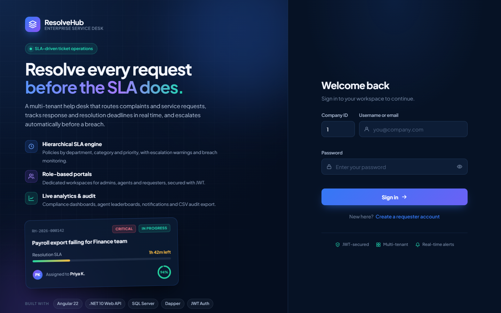
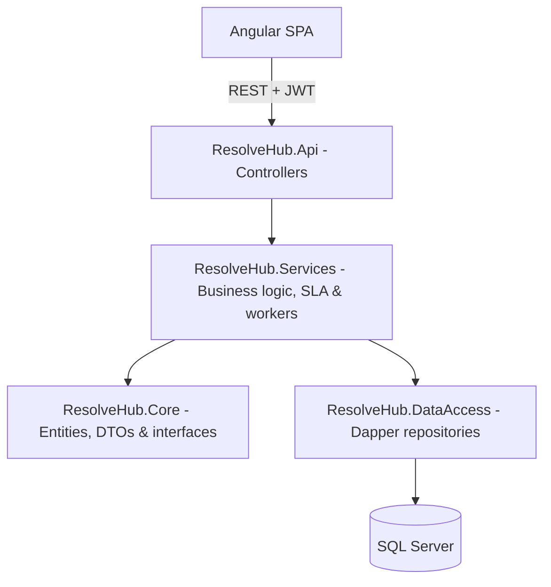

# ResolveHub – Enterprise Ticket Management System

ResolveHub is a full-stack service desk platform that helps organisations manage support requests across departments, with role-based portals, SLA tracking and automated breach monitoring.

**Tech stack:** ASP.NET Core Web API (.NET 10) · Angular 22 · Microsoft SQL Server · Dapper · Stored Procedures · JWT



<!-- After seeding demo data (see "Demo data" below), add more screenshots, e.g.:


-->

---

## Features

**Ticket management**
- Create, assign, reassign, track and resolve tickets with a full status lifecycle
  (`OPEN → ASSIGNED → IN_PROGRESS → PENDING_USER → RESOLVED → CLOSED`, plus `REJECTED`; admins can reopen)
- Four priority levels: Low, Medium, High, Critical
- Replies, activity timeline and audit history on every ticket
- Search, filtering and pagination

**SLA engine**
- SLA policies matched by department, category, priority and ticket type, with a company-wide default
- Automatic first-response and resolution deadlines, escalation warnings before a breach
- Background worker checks for SLA breaches every 60 seconds and raises alerts
- Reopened tickets start a fresh SLA cycle

**Roles and security**
- JWT authentication with role-based access control
- Three separate experiences: **Admin**, **Support Agent** and **Employee (requester)**
- User identity resolved on the server, so users can only see the data they are allowed to

**Administration and insights**
- Department, Category, Sub-category, User and SLA Policy management
- Dashboard with KPI cards and charts, plus reports
- In-app notifications with a queued delivery worker, and optional email notifications
- Light and dark themes

---

## Architecture



| Project | Responsibility |
|---|---|
| `ResolveHub.Api` | REST controllers, JWT authentication, Swagger docs |
| `ResolveHub.Services` | Business rules, ticket lifecycle, SLA monitoring and notification workers |
| `ResolveHub.Core` | Entities, DTOs and interfaces |
| `ResolveHub.DataAccess` | Dapper repositories calling SQL Server stored procedures |
| `ResolveHub.DbInitializer` | Creates the database, tables, 58 stored procedures and sample data |
| `frontend/resolvehub-ui` | Angular standalone application |

---

## Getting started

### Prerequisites
- .NET 10 SDK
- Node.js 20+ and npm
- SQL Server (Express or LocalDB)

### 1. Set up the database
Check the connection string in `src/ResolveHub.Api/appsettings.json`, then run:
```bash
dotnet run --project src/ResolveHub.DbInitializer
```

### 2. Configure the JWT signing key
The signing key is a secret, so it is not committed. Store your own random key (32+ characters) with .NET user-secrets:
```bash
dotnet user-secrets set "Jwt:Key" "<your-long-random-secret>" --project src/ResolveHub.Api
```
For production, set the `Jwt__Key` environment variable instead. The API refuses to start without a valid key.

### 3. Start the API
```bash
dotnet run --project src/ResolveHub.Api --urls "http://localhost:5102"
```
API documentation: `http://localhost:5102/swagger`

### 4. Start the frontend
```bash
cd frontend/resolvehub-ui
npm install
npm start
```
Open `http://localhost:4200`.

### Demo data (optional)
For a realistic walkthrough, replace company 1's data with a curated demo dataset —
4 departments, 5 agents, 8 requesters, 5 SLA policies and 36 tickets over the last 30 days:
```bash
# Back up first: this replaces all CompanyId = 1 data except the admin account
sqlcmd -S "localhost\SQLEXPRESS" -E -d ResolveHubDb -b -i database/demo/seed-demo-data.sql
```

### Demo accounts (local development only)
| Role | Username | Password |
|---|---|---|
| Admin | `admin` | `Admin@123` |
| Support Agent | `priya.kapoor` · `daniel.reyes` · `sara.ahmed` · `michael.chen` · `lena.fischer` | same as admin |
| Employee | `arjun.mehta` · `emily.carter` · `ravi.nair` · `tom.becker` … | same as admin |

Agent and employee accounts exist after running the demo data script.

---

## Engineering highlights
- **Layered .NET API** — controllers stay thin; business rules live in services; data access is Dapper over stored procedures.
- **Idempotent database bootstrapper** — every script is `CREATE OR ALTER` / `IF NOT EXISTS`, so it can be re-run safely to apply changes.
- **Background workers** — SLA monitoring and notification delivery run as hosted services that create their own DI scope, with idempotent correlation keys to avoid duplicate alerts.
- **Consistent API errors** — a global exception handler maps database business-rule errors to `400` JSON responses.
- **UTC everywhere** — timestamps are stored in UTC and serialized with a `Z` suffix so the browser shows correct local times.
- **Modern Angular** — standalone components, signals with zoneless change detection, and lazy-loaded routes (initial bundle ≈ 450 kB).

---

## Documentation
See [DEVELOPER_GUIDE.md](DEVELOPER_GUIDE.md) for the full technical reference: database design, role matrix, API endpoints, testing and troubleshooting.

## Author
**Fathima Nasrin T N**
[LinkedIn](https://linkedin.com/in/fathima-nasrin-8a3420291) · [GitHub](https://github.com/fathnas589) · [Portfolio](https://fathima-nasrin-portfolio.vercel.app)
